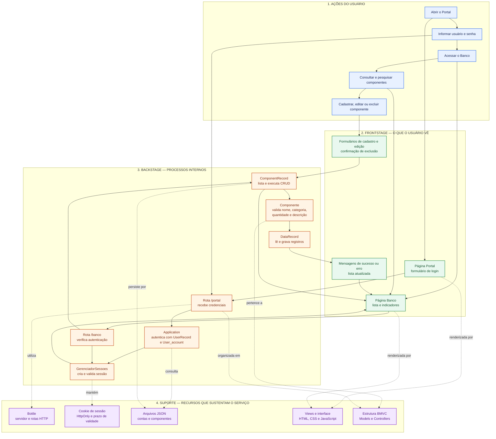

# Nível 2 — Blueprint Desktop | TechStock

Este Blueprint representa as etapas do serviço do TechStock em camadas, seguindo a estrutura demonstrada na referência da aula: **Ações do usuário, Frontstage, Backstage e Suporte**.

O conteúdo foi relacionado às funcionalidades que existem no código do projeto: acesso pelo Portal, consulta do catálogo na página Banco e manutenção dos componentes.

## Diagrama

O diagrama abaixo é Mermaid e pode ser visualizado diretamente pelo GitHub. O arquivo editável está em [blueprint-nivel-2-techstock.mmd](./blueprint-nivel-2-techstock.mmd).

## Como ler as camadas

| Camada | O que representa no TechStock |
|---|---|
| **Ações do usuário** | Abrir o Portal, informar credenciais, acessar o Banco, consultar e pesquisar componentes, cadastrar, editar e excluir. |
| **Frontstage** | As páginas, formulários, lista, indicadores, confirmações e mensagens que aparecem para o usuário. |
| **Backstage** | As rotas Bottle, autenticação, gerenciamento de sessão, coordenação pela classe `Application`, validação pelo modelo `Componente` e operações dos registros. |
| **Suporte** | Servidor Bottle, cookie de sessão, arquivos JSON, templates HTML, CSS, JavaScript e organização BMVC. |

## Relação com os arquivos do projeto

- `route.py`: define as rotas do Portal, Banco e API.
- `app/controllers/application.py`: coordena autenticação, sessões e dados usados nas páginas.
- `app/controllers/datarecord.py`: lê e grava contas e componentes em arquivos JSON.
- `app/models/user_account.py`: representa a conta e confere a senha.
- `app/models/sessao.py`: gerencia a validade das sessões.
- `app/models/componente.py`: representa e valida os dados do componente.
- `app/views/html/`: contém as páginas Portal e Banco.
- `app/static/`: contém CSS e JavaScript.

## Observação

O TechStock utiliza arquivos JSON para persistência; portanto, o diagrama não apresenta um banco de dados relacional. As setas contínuas representam o fluxo principal entre as camadas, enquanto as tracejadas indicam recursos de suporte utilizados pelos processos.
