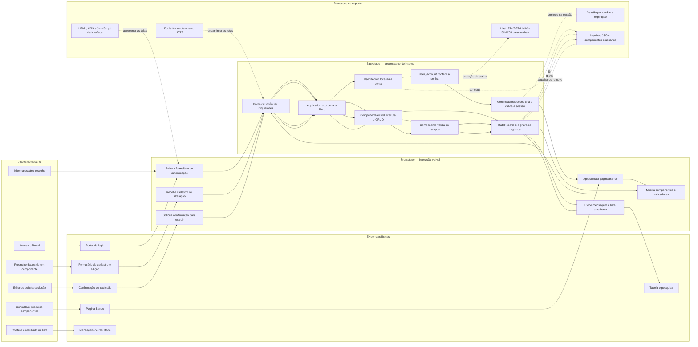

# Nível 4 — Blueprint do Serviço | TechStock

Este blueprint representa a experiência de uso do TechStock e os processos que sustentam as operações do catálogo. O fluxo foi montado a partir das rotas, modelos, controladores e telas presentes no código do projeto.

## Diagrama

O diagrama também está disponível em [formato Mermaid separado](./blueprint-nivel-4-techstock.mmd), para abrir em um editor compatível.

## Leitura do fluxo

**Evidências físicas:** telas e elementos que o usuário encontra durante a utilização: Portal, página Banco, tabela, pesquisa, formulários, confirmação de exclusão e mensagens de resultado.

**Ações do usuário:** entrar no Portal, informar as credenciais, consultar e pesquisar componentes, cadastrar, editar, excluir e conferir o resultado.

**Frontstage:** respostas visíveis da aplicação. A interface apresenta os formulários, a lista de componentes, os indicadores do catálogo e as mensagens após cada operação.

**Backstage:** a rota recebe a requisição; a classe `Application` coordena o fluxo; `UserRecord` e `User_account` participam da autenticação; `GerenciadorSessoes` controla a sessão; `ComponentRecord` executa as operações do catálogo; `Componente` valida os campos; e `DataRecord` realiza a leitura e gravação dos dados.

**Processos de suporte:** Bottle encaminha as requisições HTTP; o cookie identifica a sessão; os arquivos JSON mantêm os registros; PBKDF2-HMAC-SHA256 protege as senhas armazenadas; e HTML, CSS e JavaScript compõem a interface.

## Relação com as operações do catálogo

| Operação | Ação visível | Processamento interno |
|---|---|---|
| CREATE | Preencher o formulário e cadastrar | A rota recebe os campos, o modelo valida e o registro é salvo |
| READ | Abrir a página Banco e pesquisar | O controlador consulta os registros e a página apresenta a lista |
| UPDATE | Editar os dados e salvar | O registro é localizado, validado e gravado novamente |
| DELETE | Solicitar exclusão e confirmar | O registro é localizado e removido da lista persistida |

## Observações sobre a implementação

- O catálogo é armazenado em arquivos JSON, não em SQLite.
- A página Banco permite cadastrar, pesquisar, editar e excluir componentes.
- As operações também permanecem disponíveis por meio da API JSON.
- As sessões são mantidas durante a execução da aplicação e possuem prazo de expiração.
- A senha é verificada a partir de hash com salt; ela não é armazenada em texto puro.

O diagrama descreve o fluxo implementado no TechStock e não inclui funcionalidades que não aparecem no código atual.
