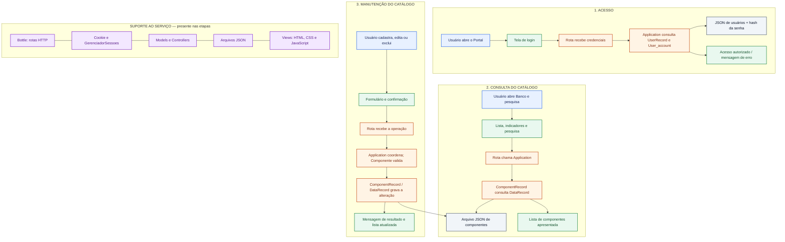

# Nível 4 — Blueprint do Serviço | TechStock

Este diagrama foi redesenhado para facilitar a leitura durante a apresentação. Ele mostra o caminho principal do serviço em três momentos: acesso, consulta do catálogo e manutenção dos componentes.

## Diagrama do Blueprint

O diagrama Mermaid abaixo pode ser visualizado diretamente no GitHub. Se preferir, abra o [arquivo Mermaid separado](./blueprint-nivel-4-techstock.mmd) em um editor compatível.

## Como interpretar

- **Ações do usuário:** abrir o Portal, entrar, consultar, pesquisar e manter o catálogo.
- **Frontstage:** telas, formulários, lista, mensagens e confirmações que o usuário vê.
- **Backstage:** rotas, Application, registros e modelos que recebem, coordenam e validam as operações.
- **Suporte:** Bottle, sessões, arquivos JSON e recursos da interface que sustentam o serviço.

## Relação com o código

| Parte do Blueprint | Elementos do projeto |
|---|---|
| Acesso | rotas do Portal, `Application`, `UserRecord`, `User_account` e `GerenciadorSessoes` |
| Consulta | rota Banco, `ComponentRecord` e `DataRecord` |
| Cadastro, edição e exclusão | formulários, rotas, `Componente`, `ComponentRecord` e `DataRecord` |
| Suporte | Bottle, cookie de sessão, JSON, HTML, CSS e JavaScript |

## Observação

O catálogo utiliza arquivos JSON para persistir componentes e contas. O diagrama representa as responsabilidades e os fluxos encontrados no código atual; não representa um banco de dados relacional.
